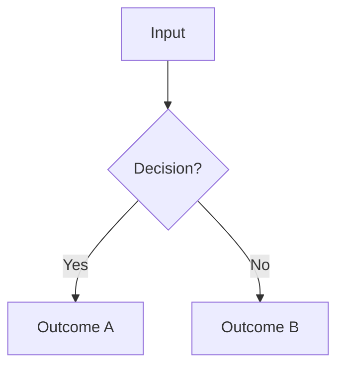

# <Title Case Name>

Source: <markdown link(s) to the exact file(s) and function(s) this document describes, e.g. `path/to/file.ts` — `functionName()`>.

<One paragraph: the business question this logic answers, in plain language, before any mechanics.>

## <Step or Stage, in the actual order of operations in the code>

<Prose describing the step. Use a fenced Mermaid diagram where a decision tree, sequence, or
branch is clearer than prose.>

$$
\text{result} = \text{formula}
$$

<One plain-language sentence explaining the formula above.>

## Edge Cases and Gotchas

- <Defaults versus adjustable parameters, clamping/fallback behavior, threshold values with units,
  and any divergence from a sibling feature.>

## What This Document Does Not Cover

- <Markdown link to a sibling topic, if one exists or is planned> — <adjacent topic>.
